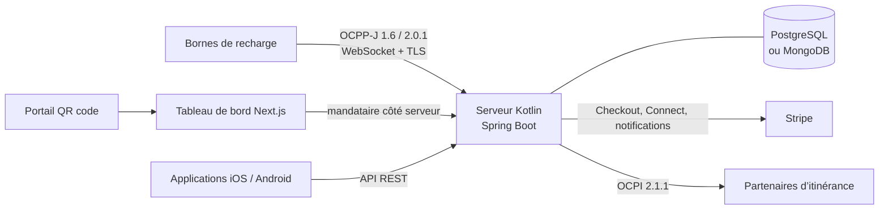

# EV Supervision Lite : supervision de bornes de recharge open source (OCPP 1.6 et OCPP 2.0.1)

[](https://github.com/codetics-software/ev-server-lite/actions/workflows/tests.yml)
[](https://codetics-software.github.io/ev-server-lite/reports/)
[](https://codetics-software.github.io/ev-server-lite/reports/server/index.html)
[](https://codetics-software.github.io/ev-server-lite/reports/dashboard/index.html)
[](https://codetics-software.github.io/ev-server-lite/reports/android/index.html)
[](https://codetics-software.github.io/ev-server-lite/reports/)
[](LICENSE)

**[English](README.md)** · **[Site web](https://codetics-software.github.io/ev-server-lite/fr/)** · **[Rapport de tests](https://codetics-software.github.io/ev-server-lite/reports/)** · **[Soutenir le projet](#soutenir-le-projet)**

> **Licence à accepter avant toute copie.** Lisez la [licence d’attribution Codetics](LICENSE) avant de télécharger, cloner ou forker ce dépôt. Télécharger, cloner ou forker ce dépôt, en tout ou en partie, vaut acceptation de cette licence. Si vous n’en acceptez pas les conditions, ne le téléchargez pas, ne le clonez pas et ne le forkez pas.

Une supervision de recharge volontairement légère : un serveur **Kotlin / Spring Boot**, un tableau de bord **Next.js**, une base **PostgreSQL** ou **MongoDB**. Développée par Kevin Vavelin, [Codetics](https://codetics.fr).

Le produit couvre les bornes et connecteurs, les commandes OCPP 1.6 et 2.0.1, les sessions, les utilisateurs et badges RFID, les sites, les tarifs et le paiement public par QR code. L’enregistrement d’un véhicule reste facultatif. Pour des besoins de supervision plus avancés, contactez Codetics.

Applications conducteurs : [iOS](ev-app-ios/README.md) et [Android](ev-app-android/README.md). Règles de licence pour les agents et outils d’IA : [AGENTS.md](AGENTS.md).

## Sommaire

- [Proposer la recharge à vos clients](#proposer-la-recharge-à-vos-clients-sous-votre-marque)
- [Fonctionnement](#fonctionnement)
- [Démarrage local](#démarrage-local)
- [Déploiement](#déploiement)
- [Fonctionnalités](#fonctionnalités)
- [Connexion des bornes](#connexion-des-bornes)
- [Documentation](#documentation)
- [Tests et couverture](#tests-et-couverture)
- [Soutenir le projet](#soutenir-le-projet)
- [Licence](#licence)

## Proposer la recharge à vos clients, sous votre marque

Un opérateur, un installateur, un intégrateur, un énergéticien, une collectivité ou un gestionnaire de flotte peut déployer ce serveur sur sa propre infrastructure, puis l’offrir à ses clients comme son propre service :

- **Un espace par client.** Chaque espace a ses bornes, ses utilisateurs, ses badges RFID, ses tarifs, ses véhicules et son compte Stripe ; les encaissements arrivent directement sur ce compte. Le serveur isole les espaces et déduit l’espace autorisé de la session. L’administrateur de l’espace téléverse son logo, affiché dans le tableau de bord et sur le portail de paiement par QR code.
- **Des applications à votre marque.** Les applications natives [iOS](ev-app-ios/README.md) et [Android](ev-app-android/README.md), avec CarPlay et Android Auto, se configurent avec `BRAND_NAME`, `API_URL`, `PORTAL_URL`, `WORKSPACE_SLUG`, `SUPPORT_EMAIL` et `PRIVACY_POLICY_URL`, puis se publient sur vos propres comptes développeur. Chaque compilation vise un espace : publiez une application pour votre réseau, ou une par client. CarPlay demande une autorisation d’Apple, Android Auto un examen de Google.
- **Votre service, vos conditions.** Le logiciel ne prélève aucune commission sur les recharges. Vous facturez à vos clients la mise en service, l’abonnement ou la maintenance comme vous l’entendez.

La [licence d’attribution Codetics](LICENSE) autorise l’usage commercial, la modification et la revente. Votre nom, votre logo, votre domaine et vos applications passent au premier plan ; la mention « EV Supervision Lite — built by Kevin Vavelin, Codetics » et https://codetics.fr restent visibles dans l’écran **À propos** des applications, et le crédit Codetics en pied de page du tableau de bord et du portail. Le [guide de personnalisation en marque blanche](docs/marque-blanche.md) indique ce qui se change et ce qui doit rester.

### Déploiement par Codetics

Si vous préférez ne pas l’installer vous-même, Codetics déploie le serveur, le tableau de bord, la base de données, HTTPS, la connexion des bornes et Stripe, puis compile et soumet les applications à votre nom sur l’App Store et Google Play, à prix fixe. Le déploiement se fait chez l’hébergeur de votre choix : AWS, Google Cloud, Microsoft Azure, OVHcloud, Scaleway, Oracle Cloud, Hostinger, Cloudflare, Vercel ou votre propre serveur. Le tableau de bord Next.js peut être hébergé sur une plateforme comme Vercel ; le serveur Java demande une machine virtuelle ou un conteneur capable de garder ouvertes les connexions WebSocket des bornes. Détails : [codetics.fr](https://codetics.fr/fr/supervision-recharge-lite). Demande : [codetics.fr/fr/contact](https://codetics.fr/fr/contact?project=mobility).

## Fonctionnement



Les bornes se connectent en WebSocket au serveur Java, qui persiste chaque commande et l’envoie une à une. Le tableau de bord passe toujours par l’API du serveur ; il ne parle jamais directement aux bornes. Le détail de la prise en charge d’OCPP 2.0.1 est dans [docs/ocpp-2.0.1.md](docs/ocpp-2.0.1.md) (en anglais).

## Organisation

```text
ev-server/src/main/kotlin/fr/codetics/ev_server/
  controllers/     Points d’entrée HTTP par domaine
  services/        Règles de gestion par domaine
  models/          Entités persistées et modèles des échanges
  repositories/    Accès aux données JPA
  security/        Comptes, sessions et autorisations
  ocpp/            Échanges avec les bornes et file de commandes
  ocpi/            Interfaces d’itinérance OCPI 2.1.1
  stripe/          Adaptateur Stripe
  core/            Configuration et utilitaires communs

ev-dashboard/
  app/             Routes et mises en page Next.js
  features/        Écrans, composants et logique par fonctionnalité
  components/ui/   Composants d’interface partagés
  lib/             Client HTTP, formats, libellés et traductions (lib/i18n)
```

## Démarrage local

Prérequis : **Java 25 ou supérieur**, **Node.js 22.23.4, 24.22.1, 26.12.1 ou une version corrective ultérieure de ces branches**. Maven est fourni par le projet.

Dans un premier terminal :

```sh
cd ev-server
SPRING_PROFILES_ACTIVE=local \
BOOTSTRAP_EMAIL=admin@example.test \
BOOTSTRAP_PASSWORD='une-phrase-de-passe-locale-a-remplacer' \
./mvnw spring-boot:run
```

Dans un deuxième terminal :

```sh
cd ev-dashboard
npm ci
npm run dev
```

Ouvrez `http://localhost:3000/auth/login`. L’identifiant de l’espace initial est `codetics`. Le profil `local` utilise une base H2 en mémoire : ses données disparaissent à l’arrêt. Le compte initial est créé uniquement lorsque la base ne contient aucun utilisateur. Retirez ensuite ses identifiants de la configuration.

## Déploiement

Le serveur s’exécute comme une application Java classique ; le tableau de bord comme une application Node.js Next.js. Aucune plateforme d’hébergement particulière n’est imposée.

```sh
cd ev-server
./mvnw verify
java -jar target/ev-server-0.0.1-SNAPSHOT.jar
```

```sh
cd ev-dashboard
npm ci
npm run build
npm run start
```

Copiez les exemples [du serveur](ev-server/.env.example) et [du tableau de bord](ev-dashboard/.env.example) dans la configuration de votre hébergeur. Spring Boot ne charge pas automatiquement un fichier `.env` : transmettez ces valeurs comme variables d’environnement.

En production, utilisez HTTPS et PostgreSQL ou MongoDB. Le serveur choisit sa base d’après `DATABASE_URL` :

- `jdbc:postgresql://hôte:5432/base` : PostgreSQL, avec `DATABASE_USER` et `DATABASE_PASSWORD`. Flyway applique les migrations ; Hibernate vérifie le schéma sans modifier les tables.
- `mongodb://utilisateur:secret@hôte:27017/base?replicaSet=rs0` ou `mongodb+srv://…` : MongoDB 8, en replica set ou derrière `mongos`, car les opérations de paiement et OCPP reposent sur des transactions. Les index sont créés au démarrage.

Toute autre adresse arrête le démarrage. Le mandataire inverse doit transmettre les connexions WebSocket OCPP au serveur Java. `EV_SERVER_URL` reste une variable privée du tableau de bord.

Le [guide de déploiement](docs/deploiement/README.md) décrit les images de conteneur, l’entrée des connexions OCPP, les profils de sécurité et une installation Docker Compose ou Kubernetes (`deploy/`), avec des guides pour [Google Cloud](docs/deploiement/gcp.md), [AWS](docs/deploiement/aws.md), [Azure](docs/deploiement/azure.md), [Scaleway](docs/deploiement/scaleway.md) et [Oracle Cloud](docs/deploiement/oracle-cloud.md).

## Espaces clients

Tous les espaces partagent la même application et peuvent utiliser la même adresse web. La connexion demande explicitement l’identifiant de l’espace. Le serveur déduit l’espace autorisé de la session, jamais du nom de domaine ni d’un identifiant d’espace envoyé avec une opération métier.

Les rôles sont **administrateur**, **exploitant**, **lecteur** et **conducteur**. Les conducteurs consultent leurs propres sessions. Chaque espace possède ses bornes, ses utilisateurs, ses badges, ses tarifs et son compte Stripe.

La création d’espaces depuis `/auth/create-workspace` s’active avec `WORKSPACE_SIGNUP_ENABLED=true`, `MAIL_ENABLED=true` et un serveur SMTP. Le premier administrateur doit vérifier son adresse électronique. L’inscription libre de conducteurs dans l’espace défini par `PUBLIC_TENANT` est une option séparée, désactivée par défaut.

## Fonctionnalités

Chaque espace active ses modules dans **Espace client** : organisation, tarifs, facturation, itinérance, recharge intelligente, statistiques, équipements, véhicules et paiement public.

- **Organisation** : entreprises, sites, zones et équipements. Les bornes sont rattachées à une zone. Un site peut réserver la recharge aux utilisateurs qui lui sont affectés et être publié en itinérance.
- **Bornes** : édition, suppression, rotation du mot de passe, paramètres OCPP, historique des événements, modèles de configuration appliqués au démarrage, profils de charge, limitation de puissance et jetons d’enregistrement automatique.
- **Sessions** : prix calculé à la fin de chaque session, courbe de consommation, inactivité, état de charge, arrêt à distance ou local, export CSV et détection des anomalies.
- **Tarifs** : portée (espace, site, zone, borne, connecteur), validité, jours, plages horaires, seuils d’énergie et de durée, prix d’énergie, de temps, de stationnement et forfait.
- **Facturation des conducteurs** : moyens de paiement et factures Stripe sur le compte connecté de l’espace, par session ou mensuelle.
- **Cartes de recharge** : vente de cartes RFID aux conducteurs sur le compte Stripe de l’espace, préparation des commandes par l’exploitant et activation dans l’application mobile.
- **Recharge intelligente** : partage de la puissance d’une zone entre les sessions, avec minimum de 6 A, consommation des équipements et profils OCPP `TxProfile`.
- **Équipements** : relevés Schneider, GreenCom, IoThink, Lacroix, WIT ou envoi direct par jeton.
- **Itinérance OCPI 2.1.1** : publication des sites, tarifs, sessions et relevés, commandes à distance, autorisation des badges partenaires, envois et récupérations manuels.
- **Notifications, statistiques et journal** : courriels selon les préférences de chaque utilisateur, statistiques mensuelles exportables, journal filtrable.

Les tâches planifiées signalent les bornes hors ligne et ferment les sessions abandonnées. Elles purgent aussi les historiques selon `app.retention`.

## Paiement public et QR code

1. Créez un tarif en euros dans **Tarifs**.
2. Dans **Paiements**, connectez le compte Stripe de l’espace et terminez la vérification chez Stripe. Activez les paiements publics.
3. Dans **Points de charge publics**, associez une borne, un connecteur physique et un tarif. Publiez le portail et téléchargez son QR code.
4. Le QR ouvre `/charge/{espace}/{point-de-charge}`. Le conducteur branche son véhicule, choisit un crédit entre 5 € et 100 € et paie via Stripe Checkout, sans créer de compte.

Les encaissements sont effectués directement sur le compte connecté de chaque espace. Le serveur attend une notification Stripe signée confirmant le paiement avant de demander le démarrage. Seul le message de démarrage de la borne confirme une recharge en cours.

Le tarif est figé au début de la demande. À la fin réelle de la recharge, le serveur calcule le montant à partir des mesures de la borne, plafonne la facturation au crédit payé et rembourse le solde. Un refus de démarrage ou l’absence de démarrage sous cinq minutes entraîne un remboursement intégral. Les reprises utilisent des clés d’idempotence Stripe.

À l’épuisement du crédit, le serveur demande l’arrêt. Cette commande dépend de la connexion et de la réponse de la borne : elle ne constitue pas une coupure physique garantie. Si la borne ne confirme pas l’arrêt, la session reste en attente du relevé final. Un remboursement refusé est signalé dans **Paiements** pour intervention de l’exploitant.

Configurez `STRIPE_SECRET_KEY`, `STRIPE_WEBHOOK_SECRET` et une clé `APP_ENCRYPTION_KEY` de 32 octets aléatoires encodés en Base64. Dans Stripe, créez une destination de notifications **pour les comptes connectés**, vers l’adresse publique `/api/backend/api/v1/stripe/webhook`, avec ces événements :

```text
checkout.session.completed
checkout.session.async_payment_succeeded
checkout.session.async_payment_failed
checkout.session.expired
invoice.paid
invoice.payment_failed
invoice.finalized
```

L’adresse peut aussi viser directement `/api/v1/stripe/webhook` sur le serveur Java si celui-ci est exposé. Utilisez des clés et une destination de test pour les essais, puis les équivalents de production. Les paiements réels nécessitent un compte Stripe actif et une borne compatible ; les tests locaux utilisent un adaptateur réservé aux tests.

## Connexion des bornes

Ajoutez une borne dans le tableau de bord et conservez son mot de passe, affiché une seule fois. Choisissez sa version OCPP : détection automatique, OCPP 1.6 ou OCPP 2.0.1. Configurez OCPP-J (JSON), le sous-protocole `ocpp2.0.1` ou `ocpp1.6` et l’authentification Basic :

```text
wss://adresse-du-serveur/ocpp/{espace}/{identifiant-borne}
Authorization: Basic <base64(identifiant-borne:mot-de-passe)>
```

Le Plug & Charge (ISO 15118) demande des certificats V2G déposés avant le démarrage du serveur : voir [Certificats ISO 15118](docs/deploiement/README.md#certificats-iso-15118-plug--charge).

En détection automatique, le serveur retient la première version proposée par la borne dans `Sec-WebSocket-Protocol`. Une version imposée refuse les connexions qui ne la proposent pas : conformément à OCPP-J, le serveur termine la poignée de main sans sous-protocole puis ferme la connexion. Les bornes existantes restent en OCPP 1.6 imposé.

La **réponse au démarrage** de chaque borne (BootNotification) se règle dans ses propriétés : **acceptée** (par défaut), **en attente** pour la configurer avant sa mise en service (elle ne reçoit alors que des commandes de configuration et ne peut pas recharger), ou **refusée**. Accepter une borne en attente lui demande aussitôt un nouveau démarrage.

Les commandes sont persistées et suivies jusqu’à la réponse ou au dépassement de leur délai. Une réponse positive à une commande de démarrage ne prouve pas que le véhicule recharge.

## Documentation

| Sujet | Document |
| --- | --- |
| Architecture et organisation du code | [docs/architecture.md](docs/architecture.md) |
| Authentification | [docs/authentication.md](docs/authentication.md) |
| Déploiement (tous hébergeurs) | [docs/deploiement/README.md](docs/deploiement/README.md) |
| Marque blanche | [docs/marque-blanche.md](docs/marque-blanche.md) |
| Prise en charge d’OCPP 2.0.1 | [docs/ocpp-2.0.1.md](docs/ocpp-2.0.1.md) |
| Tableau de bord | [ev-dashboard/README.md](ev-dashboard/README.md) |
| Application iOS | [ev-app-ios/README.md](ev-app-ios/README.md) |
| Application Android | [ev-app-android/README.md](ev-app-android/README.md) |
| Captures d’écran | [screenshots/README.md](screenshots/README.md) |

La description de l’API est réservée aux administrateurs à `/api/v1/openapi` sur le serveur Java.

## Tests et couverture

Chaque envoi et chaque demande de fusion exécutent le [processus Tests](.github/workflows/tests.yml) : vérification de la licence, tests du serveur (JUnit et JaCoCo), contrôles et tests du tableau de bord (ESLint, Prettier, traductions, Vitest), tests unitaires Android (Robolectric et JaCoCo) et iOS (XCTest et Swift Testing). Les résultats apparaissent dans le résumé de chaque exécution et dans les vérifications des demandes de fusion. Sur `main`, le rapport complet et la couverture sont publiés sur **[codetics-software.github.io/ev-server-lite/reports](https://codetics-software.github.io/ev-server-lite/reports/)** et les badges ci-dessus sont mis à jour.

```sh
cd ev-server && ./mvnw test                         # rapport : target/site/jacoco/index.html
cd ev-dashboard && npm run lint && npm run format:check && npm run test:coverage && npm run build
cd ev-app-android && ./gradlew testDebugUnitTest createDebugUnitTestCoverageReport
cd "ev-app-ios/EV App" && xcodebuild test -project "EV App.xcodeproj" -scheme "EV App" \
  -only-testing:"EV AppTests" -destination 'platform=iOS Simulator,name=iPhone 17' -enableCodeCoverage YES
bash scripts/verify-attribution.sh
```

Les essais locaux couvrent les droits, l’isolation des espaces, les échanges OCPP et le cycle de paiement avec un adaptateur Stripe de test. Ils ne remplacent pas les essais PostgreSQL, Stripe et bornes de l’installation cible.

## Soutenir le projet

EV Supervision Lite est développée et maintenue par Codetics. La meilleure façon de la soutenir est de travailler avec nous sur **[codetics.fr](https://codetics.fr)** :

- déploiement clé en main chez votre hébergeur ou sur votre serveur ;
- compilation et publication de vos applications iOS et Android en marque blanche ;
- maintenance, supervision et mises à jour ;
- fonctionnalités et intégrations sur mesure (matériel, facturation, itinérance).

[Contacter Codetics](https://codetics.fr/fr/contact?project=mobility). Le bouton **Sponsor** du dépôt renvoie aussi vers [codetics.fr](https://codetics.fr).

## Licence

Le code original est distribué sous la [licence d’attribution Codetics](LICENSE). Télécharger, cloner ou forker ce dépôt vaut acceptation de cette licence (section 7). Conservez le crédit visible à Kevin Vavelin, Codetics, ainsi que `NOTICE` et les licences des dépendances. Les textes juridiques tiers conservent leur version d’origine.
