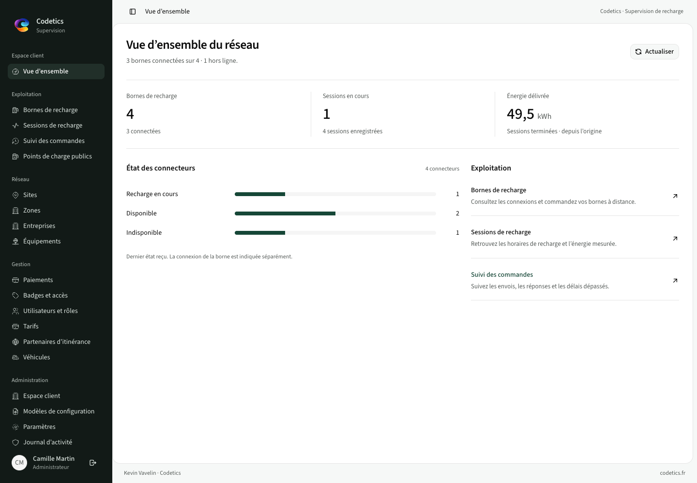
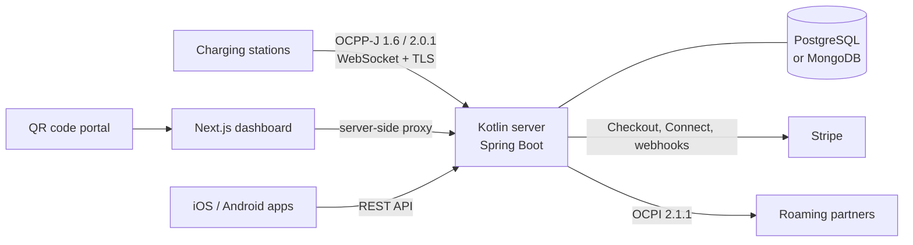

# EV Supervision Lite: open-source EV charging supervision (OCPP 1.6 & OCPP 2.0.1)

[](https://github.com/codetics-software/ev-server-lite/actions/workflows/tests.yml)
[](https://codetics-software.github.io/ev-server-lite/reports/)
[](https://codetics-software.github.io/ev-server-lite/reports/server/index.html)
[](https://codetics-software.github.io/ev-server-lite/reports/dashboard/index.html)
[](https://codetics-software.github.io/ev-server-lite/reports/android/index.html)
[](https://codetics-software.github.io/ev-server-lite/reports/)
[](LICENSE)

**[Français](README.fr.md)** · **[Website](https://codetics-software.github.io/ev-server-lite/)** · **[Test report](https://codetics-software.github.io/ev-server-lite/reports/)** · **[Support the project](#support-the-project)**

> **Accept the licence before copying.** Read the [Codetics Attribution License](LICENSE) before you download, clone or fork this repository. Downloading, cloning or forking it, in whole or in part, means you accept this licence. If you do not accept its terms, do not download, clone or fork it.

EV Supervision Lite is a self-hosted **EV charging station management system (CSMS)**. It supervises charging stations over **OCPP 1.6 and OCPP 2.0.1**, and ships with a web dashboard, white-label **iOS and Android driver apps** (with CarPlay and Android Auto), public charging paid by **QR code with Stripe**, **OCPI 2.1.1 roaming** and **ISO 15118 Plug & Charge** certificates. It is built by Kevin Vavelin, [Codetics](https://codetics.fr).

Charge point operators, installers, integrators, energy suppliers, local authorities and fleet managers can deploy it on their own infrastructure and offer it to their customers under their own brand. The software takes no commission on charging sessions.



## Contents

- [Features](#features)
- [How it works](#how-it-works)
- [OCPP 2.0.1 support](#ocpp-201-support)
- [Quick start](#quick-start)
- [Deployment](#deployment)
- [Documentation](#documentation)
- [Tests and coverage](#tests-and-coverage)
- [Support the project](#support-the-project)
- [Licence](#licence)

## Features

- **Stations and connectors**: provisioning, OCPP version (auto, 1.6 or 2.0.1), passwords and security profiles 0 to 3, OCPP parameters and device model, configuration templates, charging profiles, firmware, logs, event history and auto-registration tokens.
- **Sessions**: price computed at the end of each session, consumption curve, idle time, state of charge, remote or local stop, CSV export and anomaly detection.
- **Tariffs**: scope (workspace, site, area, station, connector), validity, days, time slots, energy and duration thresholds, energy, time, parking and flat prices.
- **Multi-tenant workspaces**: each customer has its own stations, users, RFID badges, tariffs, vehicles and Stripe account. The server isolates workspaces and derives the allowed workspace from the session.
- **Public charging by QR code**: drivers pay with Stripe Checkout without an account. The final price is computed from meter values, capped at the paid credit, and the balance is refunded.
- **Driver billing and charging cards**: payment methods and Stripe invoices on each workspace's connected account, RFID card sales and activation in the mobile app.
- **Smart charging**: power shared across sessions in an area, with a 6 A minimum, building consumption and OCPP `TxProfile` profiles.
- **Energy assets**: Schneider, GreenCom, IoThink, Lacroix, WIT or direct push by token.
- **OCPI 2.1.1 roaming**: locations, tariffs, sessions and CDRs, remote commands and partner badge authorization.
- **Notifications, statistics and audit log** per workspace and per user.
- **White-label mobile apps**: native [iOS](ev-app-ios/README.md) and [Android](ev-app-android/README.md) apps configured with `BRAND_NAME`, `API_URL`, `PORTAL_URL` and `WORKSPACE_SLUG`, published under your own developer accounts.

## How it works



- Stations connect to `wss://<server>/ocpp/{workspace}/{station}` with HTTP Basic authentication or client certificates. The server negotiates `ocpp2.0.1` or `ocpp1.6` from `Sec-WebSocket-Protocol`.
- Every command sent to a station is persisted, sent one at a time per station and tracked until its response or timeout. Commands written for OCPP 1.6 are translated automatically for OCPP 2.0.1 stations.
- The dashboard never talks to stations: it calls the server API through a server-side proxy, so the Java server can stay private.
- Data lives in PostgreSQL (Flyway migrations) or MongoDB 8 (replica set, transactions), chosen from `DATABASE_URL`.

Details: [architecture](docs/architecture.md), [authentication](docs/authentication.md).

## OCPP 2.0.1 support

All 65 OCPP 2.0.1 actions are implemented with schema-level validation: 25 messages sent by stations and 40 commands sent by the server. Highlights:

- Boot, heartbeat, status, `TransactionEvent` (including authorize-first and plug-first flows), meter values with signed data, reservations, local authorization lists and remote start/stop.
- Device model: `NotifyReport`, `GetBaseReport`, `GetReport`, `GetVariables`, `SetVariables`, monitoring and events.
- Smart charging: `SetChargingProfile`, `GetCompositeSchedule`, `NotifyEVChargingNeeds` and charging limits.
- Security: security profiles 1 to 3, certificate signing, installation and revocation, security events and network profiles.
- ISO 15118 Plug & Charge: `Get15118EVCertificate`, `GetCertificateStatus` (OCSP) and contract certificate checks.
- OCPP-J framing rules: one outstanding call per direction, RPC framework errors, message id checks, millisecond timestamps and WebSocket ping liveness.

The full list is in [docs/ocpp-2.0.1.md](docs/ocpp-2.0.1.md).

## Quick start

Requirements: **Java 25 or later** and **Node.js 22.23.4, 24.22.1 or 26.12.1** (or a later patch release of these lines). Maven is provided by the project.

```sh
cd ev-server
SPRING_PROFILES_ACTIVE=local \
BOOTSTRAP_EMAIL=admin@example.test \
BOOTSTRAP_PASSWORD='a-local-passphrase-to-replace' \
./mvnw spring-boot:run
```

```sh
cd ev-dashboard
npm ci
npm run dev
```

Open `http://localhost:3000/auth/login`. The initial workspace identifier is `codetics`. The `local` profile uses an in-memory H2 database, whose data is lost when the server stops.

## Deployment

The server runs as a standard Java application and the dashboard as a Node.js Next.js application. No hosting platform is imposed.

```sh
cd ev-server && ./mvnw verify && java -jar target/ev-server-0.0.1-SNAPSHOT.jar
cd ev-dashboard && npm ci && npm run build && npm run start
```

In production, use HTTPS and PostgreSQL or MongoDB. The reverse proxy must forward OCPP WebSocket connections to the Java server. Ready-made Docker Compose and Kubernetes files are in [`deploy/`](deploy).

- [Deployment guide](docs/deploiement/README.md): container images, OCPP ingress, security profiles, environment variables, scaling, backups.
- Cloud guides: [Google Cloud](docs/deploiement/gcp.md), [AWS](docs/deploiement/aws.md), [Azure](docs/deploiement/azure.md), [Scaleway](docs/deploiement/scaleway.md), [Oracle Cloud](docs/deploiement/oracle-cloud.md).
- [ISO 15118 certificates](docs/deploiement/README.md#certificats-iso-15118-plug--charge) for Plug & Charge.

**Prefer not to install it yourself?** Codetics deploys the server, dashboard, database, HTTPS, station connection and Stripe, then builds and submits the apps under your name on the App Store and Google Play, at a fixed price, on the cloud of your choice. [Learn more](https://codetics.fr/fr/supervision-recharge-lite) or [request a deployment](https://codetics.fr/fr/contact?project=mobility).

## Documentation

The detailed guides are written in French.

| Topic | Document |
| --- | --- |
| Architecture and code layout | [docs/architecture.md](docs/architecture.md) |
| Sign-in, sessions and providers | [docs/authentication.md](docs/authentication.md) |
| Deployment (all clouds) | [docs/deploiement/README.md](docs/deploiement/README.md) |
| White-label customization | [docs/marque-blanche.md](docs/marque-blanche.md) |
| OCPP 2.0.1 support | [docs/ocpp-2.0.1.md](docs/ocpp-2.0.1.md) |
| Web dashboard | [ev-dashboard/README.md](ev-dashboard/README.md) |
| iOS app | [ev-app-ios/README.md](ev-app-ios/README.md) |
| Android app | [ev-app-android/README.md](ev-app-android/README.md) |
| Screenshots | [screenshots/README.md](screenshots/README.md) |
| Rules for AI agents | [AGENTS.md](AGENTS.md) |

The API description is available to administrators at `/api/v1/openapi` on the Java server.

## Tests and coverage

Every push and pull request runs the [Tests workflow](.github/workflows/tests.yml): the licence check, the server tests (JUnit and JaCoCo), the dashboard checks and tests (ESLint, Prettier, i18n, Vitest), the Android unit tests (Robolectric and JaCoCo) and the iOS unit tests (XCTest and Swift Testing). Results appear in each run's summary and as check runs on pull requests. On `main`, the combined report and coverage are published at **[codetics-software.github.io/ev-server-lite/reports](https://codetics-software.github.io/ev-server-lite/reports/)**, and the badges above are updated.

Run them locally:

```sh
cd ev-server && ./mvnw test                         # report: target/site/jacoco/index.html
cd ev-dashboard && npm run test:coverage            # report: coverage/index.html
cd ev-app-android && ./gradlew testDebugUnitTest createDebugUnitTestCoverageReport
cd "ev-app-ios/EV App" && xcodebuild test -project "EV App.xcodeproj" -scheme "EV App" \
  -only-testing:"EV AppTests" -destination 'platform=iOS Simulator,name=iPhone 17' -enableCodeCoverage YES
bash scripts/verify-attribution.sh
```

These tests cover permissions, workspace isolation, OCPP exchanges and the payment cycle with a test Stripe adapter. They do not replace tests with PostgreSQL, Stripe and real stations on your target installation.

## Support the project

EV Supervision Lite is developed and maintained by Codetics. The best way to support it is to work with us at **[codetics.fr](https://codetics.fr)**:

- a turnkey deployment on your cloud or server;
- building and publishing your white-label iOS and Android apps;
- maintenance, monitoring and updates;
- custom features and integrations (hardware, billing, roaming).

[Contact Codetics](https://codetics.fr/fr/contact?project=mobility). The **Sponsor** button of this repository also links to [codetics.fr](https://codetics.fr).

## Licence

The original code is distributed under the [Codetics Attribution License](LICENSE). Downloading, cloning or forking this repository means you accept this licence (section 7). Commercial use, modification and resale are allowed. The credit "EV Supervision Lite — built by Kevin Vavelin, Codetics" and https://codetics.fr must stay visible in the apps' **About** screen and in the dashboard and portal footer. Keep `NOTICE` and the dependency licences. Third-party legal texts keep their original version. See the [white-label guide](docs/marque-blanche.md) for what can change and what must stay.
